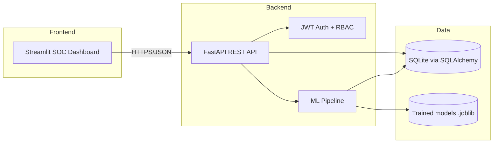

# Architecture

## Overview
This is an academic research prototype implementing the design approved in the Design Phase
(84% mark) of **AI-Driven Intrusion Detection Framework for Telemedicine Cybersecurity in South
Africa**, using a lightweight technology stack suited to the available implementation timeframe
(see [TECHNICAL_DECISIONS.md](TECHNICAL_DECISIONS.md) for the full rationale and deviations from
the original enterprise-oriented design).

## Frontend
- **Streamlit** (`frontend/streamlit_app.py`) renders a dark-themed SOC dashboard with seven
  navigation sections: Overview, Security Events, Threat Detection, Alerts, Incidents, Reports,
  Administration.
- **Plotly** renders interactive charts (severity pie chart, incident status bar chart, detection
  trend line chart, confusion-matrix heatmap).
- `frontend/api_client.py` is a thin `requests`-based wrapper that attaches the JWT bearer token to
  every backend call. The frontend holds no business logic or hardcoded statistics — every number
  shown is fetched live from the backend/database.

## Backend
- **FastAPI** application (`backend/app/main.py`) exposes REST endpoints grouped into routers:
  `auth`, `events`, `detection`, `alerts`, `incidents`, `reports` (see
  [API_DOCUMENTATION.md](API_DOCUMENTATION.md)).
  CORS is open for the local demo (`allow_origins=["*"]`) since the frontend and backend run on the
  same developer machine; this would need tightening for any non-local deployment.
- **Authentication** (`backend/app/security.py`): bcrypt password hashing (via `passlib`) and
  stateless JWT bearer tokens (via `python-jose`). Role-based access control is enforced per-endpoint
  with a `require_roles(...)` FastAPI dependency.
- **Audit logging** (`backend/app/audit.py`): every significant action (login, logout, user
  creation, event ingestion, detection runs, model training, alert acknowledgement, incident
  escalation/updates, report generation) writes an `AuditLog` row.

## AI/ML Components
Located under `backend/app/ml/`:
- `preprocessing.py` — CSV validation/normalisation (`validate_and_normalize`) and feature
  extraction (`extract_features`) shared by both training and inference.
- `rf_model.py` — `RandomForestDetector` wraps `sklearn.ensemble.RandomForestClassifier`
  (supervised, trained on labelled data) with `train/predict/save/load`.
- `if_model.py` — `IsolationForestDetector` wraps `sklearn.ensemble.IsolationForest` (unsupervised,
  trained only on rows labelled "normal" in the training split) producing a 0–1 normalised anomaly
  score, with `train/anomaly_scores/save/load`.
- `risk_scoring.py` — implements the hybrid formula `R = 0.4*A + 0.3*N + 0.2*C + 0.1*F` and maps the
  resulting 0–100 score to a severity band using configurable thresholds
  (see [TECHNICAL_DECISIONS.md](TECHNICAL_DECISIONS.md) for the scoring methodology write-up).
- `evaluate.py` — performs an explicit train/test split (`sklearn.model_selection.train_test_split`,
  `stratify=y`) on the synthetic labelled dataset, trains both models **only** on the training split,
  computes accuracy/precision/recall/F1/false-positive-rate/confusion-matrix/latency from the
  held-out test split, and writes the results to `backend/ml_models/evaluation_results.json`
  (see [TESTING_REPORT.md](TESTING_REPORT.md) for the actual recorded numbers).

Models are persisted with `joblib` under `backend/ml_models/` and loaded by the `/detection/run`
endpoint at request time (not kept in a long-lived in-process cache, to keep the prototype simple).

## Database
SQLite file created automatically on backend startup (`Base.metadata.create_all`). See
[DATABASE.md](DATABASE.md) for the full schema. SQLAlchemy ORM is used throughout; no raw SQL.

## Data Flow
1. Analyst/Administrator logs in (`POST /auth/login`) → receives JWT.
2. Analyst uploads a CSV of telemedicine security events (`POST /events/upload`) → rows are
   validated/normalised → valid rows persisted as `SecurityEvent` rows, invalid rows reported with
   explanations.
3. Administrator trains the detection models (`POST /detection/train`) against the labelled
   synthetic dataset (`backend/data/synthetic_telemedicine_events.csv`), or an analyst/administrator
   runs detection on newly-ingested, not-yet-scored events (`POST /detection/run`).
4. Each unscored event is scored by both models; a hybrid risk score and severity are computed and
   stored as a `DetectionResult`; medium/high/critical results automatically generate an `Alert`.
5. Analysts triage alerts (acknowledge / escalate) via the Alerts page; escalation creates an
   `Incident` linked to the alert.
6. Analysts investigate incidents, add notes, and update status through to resolution/closure; every
   status change and note is recorded in `IncidentNote` and `AuditLog`.
7. Reports page aggregates live counts from the database and lets the analyst export a CSV of
   alerts or a PDF summary; administrators can view the full audit log.

## Security Controls
- Passwords are hashed with bcrypt (`passlib`), never stored or logged in plaintext.
- All non-login endpoints require a valid JWT bearer token; sensitive endpoints additionally require
  the `administrator` role (user management, model training, audit log access).
- Uploaded CSVs are parsed with `pandas` and every row is explicitly validated (required columns,
  numeric types, non-empty IP/user identifier) before being persisted — malformed or malicious rows
  are rejected and reported, not silently inserted.
- See [TECHNICAL_DECISIONS.md](TECHNICAL_DECISIONS.md) for documented prototype-level security
  limitations (e.g. `SECRET_KEY` default, open CORS, stateless logout).

## Main Application Workflows
See the "Demonstration workflow" section of [README.md](README.md) for the exact click-through
sequence used to validate REQ-001 through REQ-007 end-to-end.
