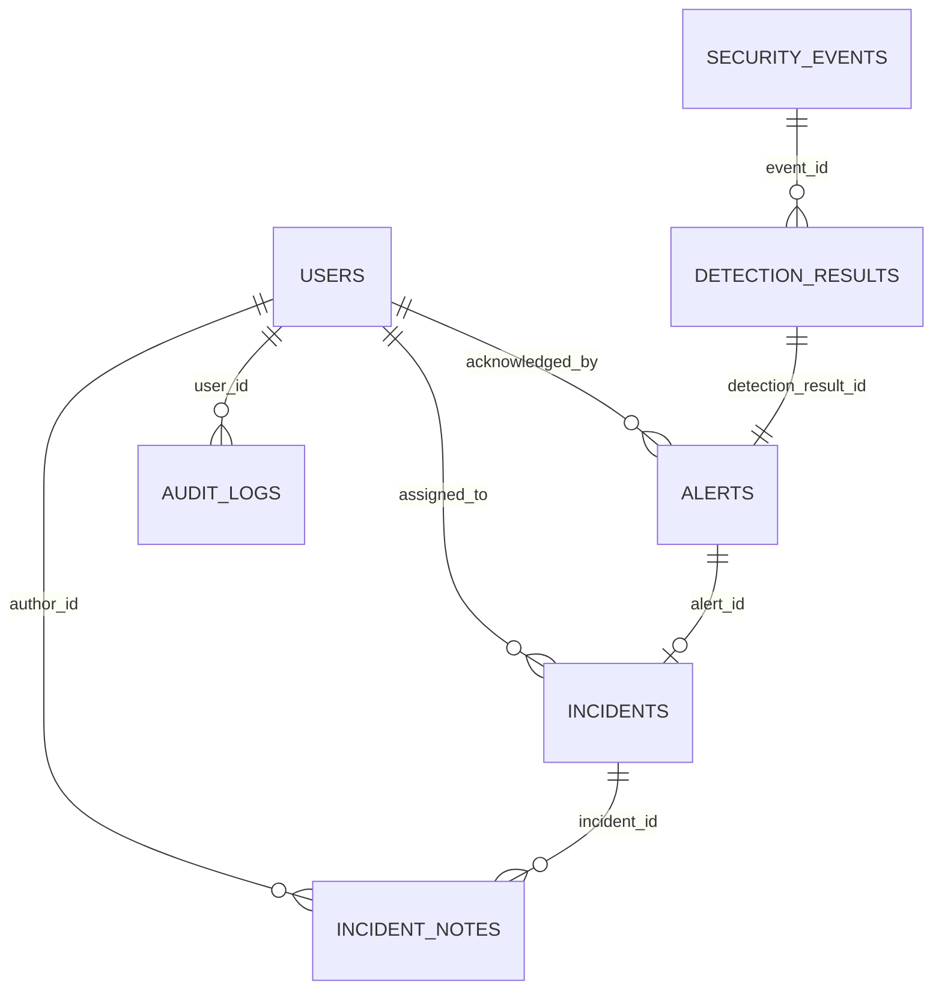

# Database Design

SQLite database, managed through SQLAlchemy ORM (`backend/app/models.py`). Tables are created
automatically on backend startup via `Base.metadata.create_all`. No manual migration step is
required for this prototype (see [TECHNICAL_DECISIONS.md](TECHNICAL_DECISIONS.md) for the
limitation this implies).

## Entity-Relationship Overview

## Tables

### users
| Column | Type | Notes |
|---|---|---|
| id | Integer PK | |
| username | String(50) | unique, indexed |
| email | String(120) | unique |
| password_hash | String(255) | bcrypt hash, never plaintext |
| role | String(30) | `administrator` or `security_analyst` |
| is_active | Boolean | disables login without deleting the account |
| created_at | DateTime | |

### security_events
| Column | Type | Notes |
|---|---|---|
| id | Integer PK | |
| timestamp | DateTime | indexed; event occurrence time |
| source_ip | String(45) | indexed |
| destination_ip | String(45) | |
| user_id | String(50) | indexed; **external** telemedicine platform user identifier (not an FK to `users`) |
| login_attempts | Integer | |
| failed_login_attempts | Integer | |
| request_frequency | Float | requests/minute-equivalent |
| session_duration | Float | seconds |
| data_transfer_volume | Float | KB |
| access_type | String(50) | `web_portal` / `mobile_app` / `api` / `admin_console` |
| device_information | String(100) | device/OS category |
| geo_location | String(100) | nullable |
| attack_label | String(50) | nullable; ground-truth label, only populated for synthetic/labelled data |
| created_at | DateTime | ingestion time |

Composite index: `(timestamp, source_ip)`.

### detection_results
| Column | Type | Notes |
|---|---|---|
| id | Integer PK | |
| event_id | Integer FK → security_events.id | indexed |
| random_forest_prediction | Integer | 1 = suspicious, 0 = normal |
| attack_probability | Float | Random Forest probability (0–1) |
| anomaly_score | Float | Isolation Forest normalised anomaly score (0–1) |
| risk_score | Float | hybrid score, 0–100 |
| severity | String(20) | `critical` / `high` / `medium` / `low`, indexed |
| detection_explanation | Text | human-readable explanation of the score |
| created_at | DateTime | |

### alerts
| Column | Type | Notes |
|---|---|---|
| id | Integer PK | |
| detection_result_id | Integer FK → detection_results.id | |
| title | String(200) | |
| description | Text | |
| severity | String(20) | indexed |
| risk_score | Float | |
| status | String(20) | `open` / `acknowledged` / `escalated` / `closed`, indexed |
| acknowledged_by | Integer FK → users.id | nullable |
| acknowledged_at | DateTime | nullable |
| created_at | DateTime | |

Alerts are auto-generated by `/detection/run` for any event scored `medium`, `high`, or `critical`.

### incidents
| Column | Type | Notes |
|---|---|---|
| id | Integer PK | |
| alert_id | Integer FK → alerts.id | |
| title | String(200) | |
| description | Text | |
| status | String(20) | `open` / `investigating` / `escalated` / `resolved` / `closed`, indexed |
| assigned_to | Integer FK → users.id | nullable |
| investigation_notes | Text | concatenated note history (human-readable) |
| resolution_notes | Text | nullable |
| created_at | DateTime | |
| updated_at | DateTime | auto-updated on status change |
| resolved_at | DateTime | nullable, set when status becomes `resolved` |

### incident_notes *(addition beyond the originally specified schema — see TECHNICAL_DECISIONS.md)*
| Column | Type | Notes |
|---|---|---|
| id | Integer PK | |
| incident_id | Integer FK → incidents.id | indexed |
| author_id | Integer FK → users.id | nullable |
| note | Text | |
| created_at | DateTime | |

Provides a structured, queryable append-only history of investigation notes and status changes per
incident, in addition to the flat `investigation_notes` text field.

### audit_logs
| Column | Type | Notes |
|---|---|---|
| id | Integer PK | |
| user_id | Integer FK → users.id | nullable (e.g. failed logins before identity is known) |
| action | String(100) | indexed; e.g. `user_login`, `event_ingestion`, `threat_detection_run`, `model_training`, `alert_acknowledged`, `incident_created`, `incident_status_update`, `incident_note_added`, `report_generated`, `report_export_csv`, `report_export_pdf`, `user_created` |
| description | Text | |
| timestamp | DateTime | indexed |
